# 4계층 아키텍쳐 (4-layer Architecture)
---
코드이 해석 능력, 구상, 설계, 전체를 볼 수 있는 능력이 중요. 
좋은 코드란? 의존성이 적은 코드. 

### 4계층 
1. 표현계층: presentation layer
2. 응용 서비스 계층: application
3. **도메인 계층: domain** (가장중요)
    - 도메인 계층?
    - 특정 영역의 전문 지식. 
    - 비지니스 영역의 해결해야 할 문제.
    - 도메인 규칙 = 비지니스 요구사항.
4. 인프라 계층: infrastructure

여기서 중요한 개념이 이 layers of isolation! 

**layers of isolation**

**changes made in one layer of the architecture generally don’t impact or affect components in other layers**

important concept is that each layer in the architecture is closed once the request goes through the layer.

architecturally restricted access

presentation layer : doesn’t know where the data is, how it is retreived. it just forwards it onto <u>customer delegate module</u>. it knows which module can process that request and how to get to that module. 

in business layer, there’s a <u>customer object</u> responsible for aggregating all the information needed by the business request. 

this module calls out to the <u>customer DAO(data access object)</u> in persistent layer. This DAOs execute SQL statments.

# DDD 

> 도메인 주도 설계(DDD)의 핵심 개념과 바운디드 컨텍스트를 학습한 내용을 정리한 노트입니다.
> 개념은 흐름대로 요약하고, 막혔던 질문과 FastAPI 코드 구조는 따로 자세히 적었습니다.

---

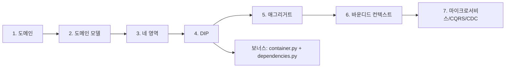

---

## 1. 큰 그림: 개념들의 크기 관계

DDD를 이해하는 가장 빠른 길은 개념들이 **서로 다른 크기의 상자**라는 점을 잡는 것입니다. 도메인은 아파트 단지 전체, 하위 도메인은 단지 안의 구역, 바운디드 컨텍스트는 구역을 실제로 어떻게 만들지 정한 울타리, 애그리거트는 울타리 안의 한 가구, 엔티티와 밸류는 가구를 이루는 구성원입니다.

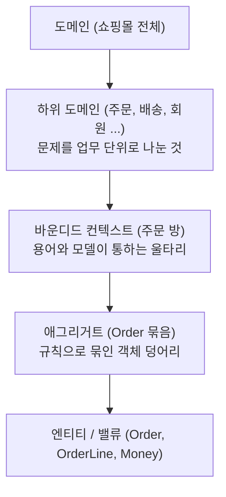

| 개념 | 답하는 질문 |
|---|---|
| 하위 도메인 | 우리 비즈니스는 무슨 일들로 이루어져 있지? |
| 바운디드 컨텍스트 | 이 용어와 모델은 어디까지 같은 뜻이지? |
| 애그리거트 | 울타리 안에서 무엇을 한 덩어리로 묶어 규칙을 지키지? |

---

## 2. 청크별 핵심 요약

### 2-1. 도메인과 하위 도메인

도메인은 소프트웨어가 해결하려는 비즈니스 문제 영역이고, 업무 지식과 규칙과 용어를 모두 포함합니다. 온라인 서점이라면 카탈로그, 주문, 결제, 배송, 혜택 같은 하위 도메인으로 나뉩니다. 하위 도메인 구성은 비즈니스 상황에 따라 달라지며(기업 대상 장비 판매는 카탈로그와 주문서면 충분), 모든 기능을 직접 만들 필요도 없습니다(배송은 외부 업체를 연동하고 추적만 통합). 그래서 "우리 비즈니스에 정말 필요한가?"를 먼저 물어야 합니다.

요구사항을 잘못 이해하면 큰 비용이 들기 때문에 네 가지 원칙을 지킵니다.

| 원칙 | 핵심 |
|---|---|
| 직접 대화 우선 | 전달자 없이 전문가와 개발자가 직접 소통 |
| 계속 검증 | 한 번 문서화하고 끝내지 않음 |
| 가시화 우선 | 목업, 프로토타입, 샘플 데이터로 보여줌 |
| 책임과 소유 명확화 | 최종 결정권자(PO 등)를 분명히 함 |

### 2-2. 도메인 모델 구성요소

도메인 모델은 업무 개념과 규칙을 객체로 표현한 것이며, 데이터 상자가 아니라 **비즈니스 로직을 포함**합니다. 엔티티와 밸류를 구분하는 기준은 하나의 질문입니다.

> **"값이 똑같다면 같은 걸로 봐도 될까?"** 된다 → 밸류, 안 된다 → 엔티티

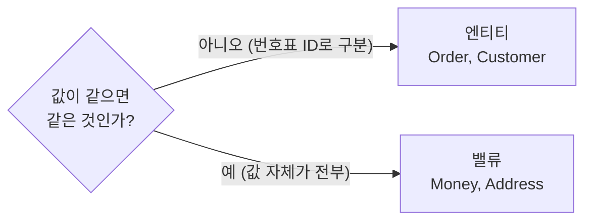

| | 엔티티 | 밸류 |
|---|---|---|
| 비유 | 학번이 있는 학생 | 천 원짜리 지폐 |
| 구분 기준 | ID | 값 |
| 바꿀 때 | 그 객체를 수정 (개명) | 새 값으로 통째로 교체 |
| set 메서드 | 변경 메서드로 규칙 거쳐 변경 | 만들지 않음 (불변) |

밸류에 set을 만들지 않는 이유는, 여러 주문이 같은 `Money` 객체를 공유할 때 한쪽을 바꾸면 다른 쪽도 몰래 바뀌는 사고가 나기 때문입니다(같은 지폐를 둘이 나눠 쓰다 한 명이 금액을 고쳐 쓰는 상황). 불변이면 일관성, 스레드 안전성, 공유와 재사용이 보장됩니다.

가장 중요한 설계 원칙은 **비즈니스 규칙을 도메인 객체 안에 두는 것**입니다. "취소할 수 있는가"는 서비스(홀 직원)가 아니라 `Order`(주방 직원)가 알아야 합니다.

```java
// 서비스는 시키기만 한다
order.cancel();

// 규칙은 Order가 안다
public void cancel() {
    if (status == SHIPPED) throw new IllegalStateException("배송 중에는 취소 불가");
    this.status = CANCELED;
}
```

여러 엔티티의 정보가 필요한 계산(예: VIP 고객이 특정 상품군을 사면 추가 할인)은 어느 한 객체에 억지로 넣지 않고, 상태 없이 계산만 하는 **도메인 서비스**로 둡니다.

### 2-3. 네 개의 영역과 계층 구조

레스토랑 비유로 정리하면 이렇습니다.

| 영역 | 레스토랑 | 하는 일 |
|---|---|---|
| 표현 | 홀 서버 | 요청 받고 결과를 응답 형태로 변환 (HTTP, JSON) |
| 응용 | 주방장 | 흐름 지휘 (트랜잭션, 권한, 이벤트). 규칙은 모름 |
| 도메인 | 레시피와 요리사 | 진짜 업무 규칙 |
| 인프라 | 냉장고, 가스레인지 | DB, 메시징, 외부 API 같은 기술 구현 |

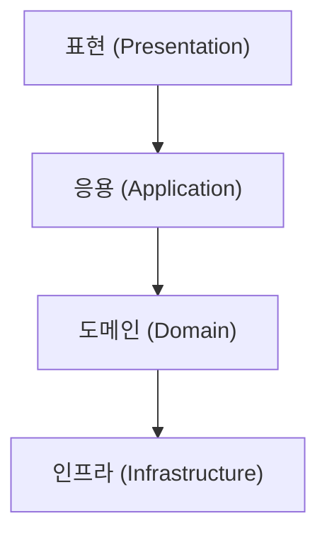

의존은 위에서 아래로만 흐르는 것이 원칙입니다. 다만 위 계층이 인프라의 **구체 구현**에 직접 묶이면 기술 교체와 테스트가 어려워지는데, 이 문제를 푸는 것이 DIP입니다.

### 2-4. DIP (의존 역전 원칙)

사장님(고수준, 도메인)이 외주 업체(저수준, 인프라)에 직접 전화를 걸던 구조를 뒤집어, **사장님이 주문서(인터페이스)를 직접 쓰고 업체가 그 주문서에 맞춰 만들게** 하는 것이 DIP입니다. 핵심은 인터페이스를 **고수준 쪽에 둔다**는 점입니다. 인프라 쪽에서 `RuleEngine` 같은 인터페이스를 뽑아내면 형식만 인터페이스일 뿐 도메인이 여전히 인프라를 바라보는 잘못된 적용입니다.

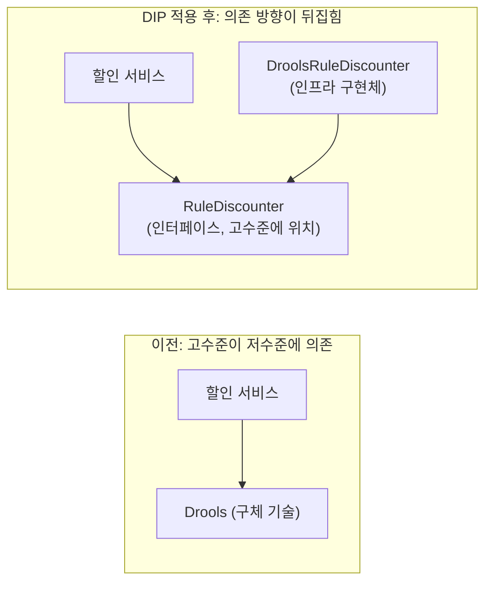

구현체는 의존성 주입(밖에서 생성자로 끼워 주는 것)으로 연결합니다. 그러면 구현 교체는 인프라 안에서만 끝나고, 테스트에서는 Mock(가짜 객체)을 끼워 DB 없이 검증할 수 있습니다. 단, 모든 곳에 적용하면 인터페이스 폭발이 오므로 **교체 가능성이 높거나 테스트 이득이 큰 곳부터 점진적으로** 적용합니다.

### 2-5. 애그리거트

애그리거트는 라이브러리의 기능이 아니라, 우리가 만든 클래스들을 "한 팀으로 묶자"고 정하는 **설계 약속**입니다. 같이 바뀌어야 하고 규칙(불변식)을 함께 지켜야 하는 것끼리 묶고, 외부는 **루트(문지기)를 통해서만** 접근합니다. 루트를 건너뛰고 항목을 직접 고치면 "총액 = 항목 합계" 같은 불변식이 깨집니다.

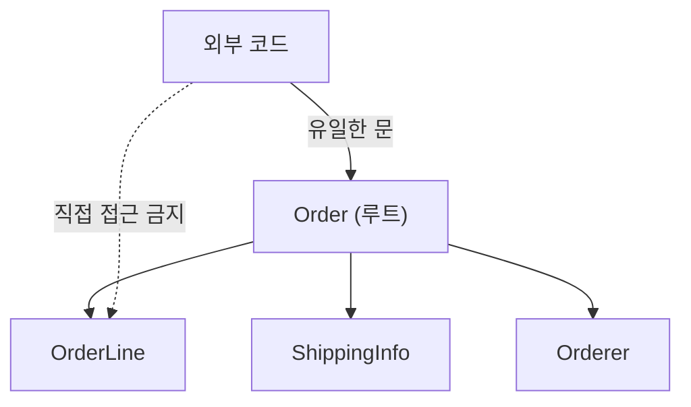

| 설계 원칙 | 핵심 |
|---|---|
| 작게 유지 | 크면 동시성 충돌, 느려짐, 트랜잭션 비대 |
| 다른 애그리거트는 ID로만 참조 | `Customer customer` 대신 `String customerId` |
| 한 트랜잭션에 보통 하나의 애그리거트 | 경계를 선명하게 |
| 협업은 도메인 이벤트 + 최종적 일관성 | 주문 완료 알림을 보내고 재고는 조금 뒤에 줄임 |
| 리포지토리는 애그리거트 단위 | `OrderLineRepository`는 만들지 않음 |

이벤트 방식의 대가는 "당장 완벽한 일관성"을 포기하는 것이며, 중간에 실패하면 이미 한 일을 되돌리는 보상 작업(사가)이 필요합니다. 애그리거트는 **도메인 계층에 존재**하고, 다른 계층은 리포지토리로 꺼내 쓰거나 저장해 줄 뿐입니다(표현 계층은 DTO로 변환해서 주고받음).

### 2-6. 바운디드 컨텍스트

같은 사람이 회원팀에서는 "회원", 주문팀에서는 "주문자", 배송팀에서는 "보내는 사람"으로 불리고, 부서마다 필요한 정보와 규칙도 다릅니다. 이를 한 장의 카드(클래스)에 모두 적으면 필드가 부풀고 팀들이 서로 눈치를 보며 한 부서의 변경이 다른 부서에 번집니다. 그래서 **부서마다 자기 카드를 따로** 가지며, 같은 말이 같은 뜻으로 통하는 하나의 울타리가 바운디드 컨텍스트입니다.

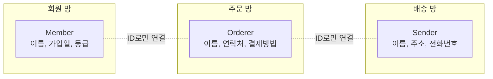

경계를 찾는 기준은 용어(의미)가 달라지는 지점, 업무 흐름과 책임, 모델 충돌 구간, 팀 경계, 기술 제약(레거시)입니다. 폴더 구조 같은 개발자 취향은 기준이 아닙니다. 중요성은 모호성 제거, 복잡도 관리, 팀 책임 분리, 모델 일관성입니다.

### 2-7. 바운디드 컨텍스트와 마이크로서비스 (개념까지 학습)

모든 방을 DDD로 만들 필요는 없습니다. 규칙이 많은 주문은 DDD, 단순한 리뷰는 CRUD(서비스+DAO)로 충분합니다. 한 방 안에서도 쓰기(Command)는 도메인 모델로, 읽기(Query)는 서비스+DAO로 나누는 **CQRS**를 쓸 수 있고, 방마다 다른 기술 스택을 써도 됩니다. 바운디드 컨텍스트는 마이크로서비스의 자연스러운 단위지만 1:1은 권고일 뿐이며, 서비스 경계는 비즈니스 의미 기준, DB는 서비스별 분리, 연계는 **계약 기반 개발(CDC)**, 배포는 독립적으로 가져갑니다. CDC는 소비자(호출하는 쪽)가 원하는 형태를 계약으로 먼저 정하고 제공자가 이를 지키게 하는 방식으로, 제공자가 몰래 응답 모양을 바꾸는 사고를 미리 잡아 줍니다.

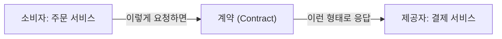

---

## 3. 보너스: FastAPI에서 container.py와 dependencies.py로 의존성 주입하기

### 3-1. 왜 필요한가 (핵심 한 줄)

> 누가 어떤 구현체를 쓸지 **고르는 일**을 한 곳(`container.py`)에 모으고, 나머지 코드는 구현체 이름을 아예 모르게 한다.

처음에는 presentation(라우터)이 infrastructure를 직접 `import`해서 "내가 쓸 도구는 이거야"라고 고르고 있었습니다. 이러면 DB를 바꿀 때 라우터까지 고쳐야 하고, 테스트하려면 진짜 DB가 있어야 합니다.

비유하면 치킨집 홀 직원 민수가 주방 기계 브랜드(삼성 냉장고)를 직접 사 오는 격입니다. 사장님이 LG로 바꾸면 민수의 코드도 고쳐야 합니다. 해법은 **인력 배치 담당 사장님**을 두는 것입니다.

| 코드 | 비유 | 역할 |
|---|---|---|
| `container.py` | 사장님 | 어떤 도구를 쥐여 줄지 모두 결정하고 조립 |
| `dependencies.py` | 직원 배정표 | 라우터에 서비스를 꽂아 줌 |
| 라우터 (presentation) | 민수 | 배정받은 직원에게 일만 시킴, 브랜드는 모름 |
| 서비스 / 도메인 | 주방장 | 인터페이스만 알고 구현체는 모름 |

### 3-2. 변화 전후

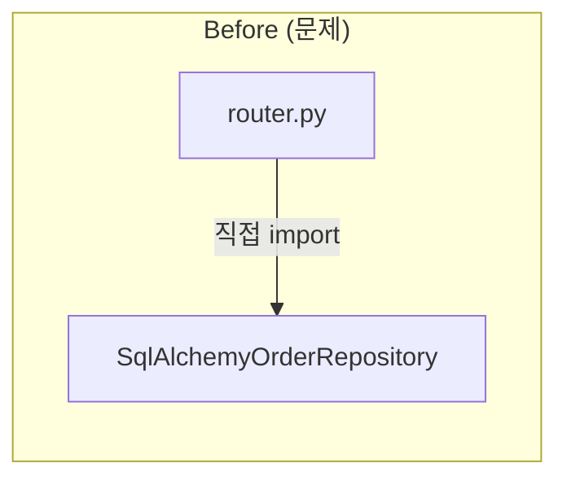

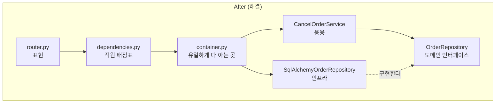

한 줄로 줄이면 이렇습니다.

```
Before: router ──import──▶ SqlAlchemyOrderRepository
After : router ──▶ dependencies.py ──▶ container.py ──▶ SqlAlchemyOrderRepository
```

### 3-3. 코드로 보기 (FastAPI 기준)

**1. 도메인: 약속(인터페이스)만 정의**

```python
# domain/order/repository.py
from abc import ABC, abstractmethod

class OrderRepository(ABC):          # ABC = "이 약속을 지켜야 하는 틀"
    @abstractmethod                  # 자식 클래스가 반드시 구현해야 하는 메서드 표시
    def find_by_id(self, order_id: str): ...
    @abstractmethod
    def save(self, order): ...
```

**2. 응용: 약속(인터페이스)만 알고, 도구는 밖에서 받는다**

```python
# application/order/cancel_order_service.py
class CancelOrderService:
    def __init__(self, order_repository: OrderRepository):   # 밖에서 받음 = 의존성 주입
        self._order_repository = order_repository

    def cancel_order(self, order_id: str):
        order = self._order_repository.find_by_id(order_id)
        order.cancel()
        self._order_repository.save(order)
```

`__init__`은 객체가 만들어질 때 실행되는 시작 함수(생성자)이고, 여기로 도구를 받는 것이 **주입**입니다.

**3. 인프라: 약속을 지키는 구현체**

```python
# infrastructure/order/sqlalchemy_order_repository.py
class SqlAlchemyOrderRepository(OrderRepository):   # 약속을 지키겠다
    def find_by_id(self, order_id): ...   # 진짜 DB 코드
    def save(self, order): ...
```

**4. container.py: 사장님이 전부 조립하는 유일한 장소**

```python
# src/container.py
from src.infrastructure.order.sqlalchemy_order_repository import SqlAlchemyOrderRepository
from src.application.order.cancel_order_service import CancelOrderService

class Container:
    def __init__(self):
        # 어떤 구현체를 쓸지 여기서만 결정
        order_repository = SqlAlchemyOrderRepository()
        # 서비스에 끼워서 완성
        self.cancel_order_service = CancelOrderService(order_repository)

container = Container()     # 앱 전체에서 쓸 사장님 한 명
```

infrastructure를 import해도 되는 곳은 사실상 여기뿐이며, 이런 곳을 **조립 지점(Composition Root)**이라 부릅니다.

**5. dependencies.py: 직원 배정표**

```python
# src/order/dependencies.py
from src.container import container

def get_cancel_order_service():
    return container.cancel_order_service
```

**6. 라우터: 민수는 일만 한다**

```python
# presentation/order/router.py
from fastapi import APIRouter, Depends
from src.order.dependencies import get_cancel_order_service

router = APIRouter()

@router.post("/orders/{order_id}/cancel")
def cancel(order_id: str, service = Depends(get_cancel_order_service)):
    service.cancel_order(order_id)
```

`Depends(...)`는 FastAPI의 기능으로 "이 함수를 실행해서 나온 값을 매개변수에 알아서 넣어 줘"라는 뜻입니다. 라우터가 `service`의 출처를 모르며, 라우터 파일에서 **infrastructure import가 사라진 것**이 핵심입니다.

### 3-4. 이렇게 하면 뭐가 좋은가

1. **DB 교체**: `container.py`의 한 줄(`SqlAlchemy...` → `Mongo...`)만 바꾸면 끝. 라우터와 서비스는 수정 없음.
2. **테스트**: 가짜 저장소를 끼워 DB 없이 검증.

```python
app.dependency_overrides[get_cancel_order_service] = \
    lambda: CancelOrderService(FakeOrderRepository())
```

3. **방향이 깔끔**: presentation이 infrastructure를 모르니 계층 규칙(3장, 4장)이 지켜짐.

### 3-5. 자주 나오는 궁금증

- **container가 infrastructure를 import하면 결국 같은 거 아닌가?** 알아야 하는 곳은 어딘가에 있어야 합니다. 차이는 "모든 곳이 아는 것"과 "딱 한 곳만 아는 것"입니다.
- **dependencies.py는 왜 도메인 폴더마다 있나?** 도메인별로 필요한 배정이 다르고 한 파일에 몰리면 커지기 때문입니다. 규모가 작으면 합쳐도 됩니다.
- **schema, models는 presentation에 둬도 되나?** 요청/응답 모양을 정의하는 DTO 성격이면 표현 계층이 자연스럽습니다. 단 DB 테이블용 ORM 모델은 **infrastructure** 쪽입니다. 이름이 같은 `models`라도 용도로 구분합니다.

### 3-6. 남은 확인 문제

1. 비유에서 (a) 사장님 (b) 직원 배정표 (c) 민수 (d) 냉장고 브랜드는 각각 코드의 무엇인가?
2. 라우터가 `from infrastructure... import SqlAlchemyOrderRepository`를 직접 하면 무엇이 틀렸고, DB를 MongoDB로 바꿀 때 어떤 일이 생기는가?
3. infrastructure를 import해도 되는 곳은 사실상 어디이며 이유는?

---

## 4. 코드를 쓰는 순서와 계층별 위치

도메인은 업무 규칙이 있는 핵심이고 인프라와 화면은 교체 가능한 도구이므로 **핵심부터 만드는 것**이 권장 순서입니다. DB 없이도 `Order.cancel()` 규칙을 먼저 테스트할 수 있고, 테이블부터 설계해서 규칙 없는 데이터 상자가 되는 것을 막아 줍니다. 다만 엄격한 규칙이 아니라 사고 순서이며, 단순 CRUD 기능에는 해당하지 않습니다.

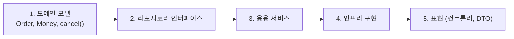

| 구성요소 | 위치 |
|---|---|
| 엔티티, 밸류, 애그리거트, 도메인 서비스, 도메인 이벤트 | 도메인 |
| 리포지토리 **인터페이스** | 도메인 |
| 리포지토리 **구현체** | 인프라 |
| 응용 서비스 | 응용 |
| DTO, 컨트롤러 | 표현 |

기억법은 **"업무 규칙을 아는 것은 도메인, 기술을 아는 것은 인프라"** 입니다.


---

## 7. 내가 했던 질문 모음 (Q&A)

| 질문 | 핵심 답변 |
|---|---|
| set이 뭐야? | 객체의 값을 **바꾸는** 메서드. `setAmount(100)`은 "금액을 100으로 바꿔라". 읽는 쪽은 `get`. 밸류에는 set을 만들지 않는 이유는 공유된 값이 몰래 바뀌는 사고를 막기 위해서 |
| 애그리거트는 어디에서 나오는 객체야? | 라이브러리가 주는 게 아니라 **우리가 정하는 묶음 + 접근 규칙**. 학교의 "모둠" 정하기와 같음. 루트는 평범한 클래스를 대표로 정한 것 |
| 이걸 4계층 모두에서 쓰는 거야? | 아니요, 애그리거트는 **도메인 계층 안에** 존재. 응용은 꺼내서 시키고, 인프라는 저장/조회를 구현하고, 표현은 DTO로 변환해서 주고받음 |
| 결국 entity랑 value object가 뭐라는 거야? | "값이 같으면 같은 걸로 봐도 되나?" 된다 → 밸류, 안 된다 → 엔티티. 학생(학번)과 천 원짜리 지폐 |
| 도메인 레이어에 이것들이 있어야 해? | 엔티티, 밸류, 애그리거트, 도메인 서비스, 도메인 이벤트, 리포지토리 **인터페이스**는 도메인. 리포지토리 **구현체**는 인프라 |
| 도메인을 먼저 작성하는 게 코드 작성 순서에 맞지? | 네. 도메인 → 리포지토리 인터페이스 → 응용 → 인프라 → 표현. 핵심 규칙부터 만들고 도구는 나중에. 다만 사고의 순서이지 엄격한 규칙은 아님 |
| 애그리거트와 하위 도메인의 차이가 헷갈려 | 아파트 비유: 하위 도메인은 구역(문제 영역), 바운디드 컨텍스트는 구역의 울타리(모델 경계), 애그리거트는 울타리 안의 한 가구(일관성 묶음) |
| presentation이 infrastructure를 import하는데 container.py와 dependencies.py로 주입해야 한다는 게 이해가 안 가 | 3장 전체. 고르는 일을 container 한 곳에 모으고, dependencies.py가 `Depends`로 라우터에 꽂아 줌 |

